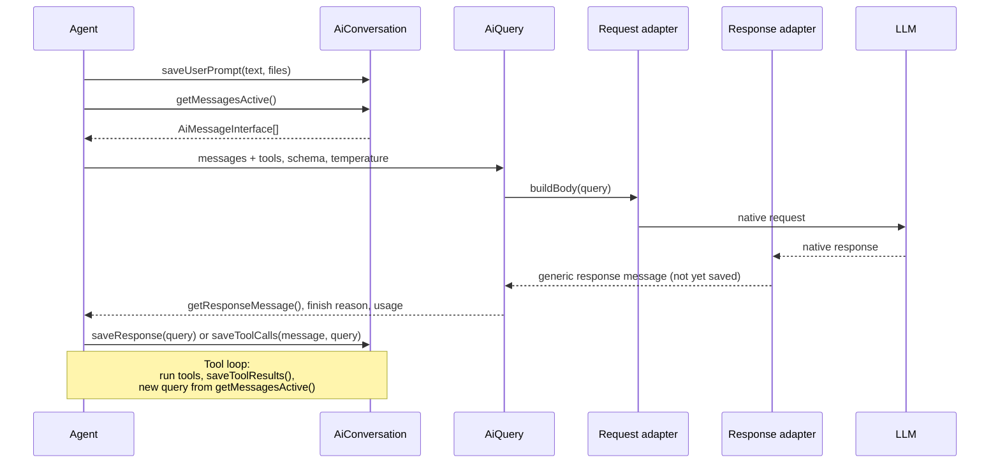

# Talking to an LLM

This page is a short overview for developers. It explains how an agent talks to an LLM, which classes are involved and what each of them is responsible for. Details are documented in [AI agents](../AI/Agents/index.md#messages-queries-and-api-adapters) and [Conversations](../AI/Conversations/index.md).

## Transparency comes first

App designers are not programmers, but they must be able to understand **why** an agent behaved the way it did - in order to improve its instructions, concepts and tools. The conversation log is their main source of evidence. Therefore:

- **Everything that happens is saved as a conversation message:** system prompt, user prompts, answers, tool calls and their results, warnings and errors.
- **Every message is readable.** `toMarkdown()` produces a designer-friendly representation, which is shown in the conversation log.
- **Nothing is hidden in API-specific formats.** What the LLM saw and what it answered must be visible to designers - no matter which API was used.

When you add a feature, always ask yourself: _will a designer see what happened in the conversation log?_ If not, make it visible - e.g. as a message or a warning.

## Conversations, queries and APIs

A **conversation** is the persisted history of one exchange between a user (or another agent) and one agent version. It may consist of many requests to the LLM.

A **query** is one such request: the agent selects messages from the conversation, adds request settings (tools, response schema, temperature, etc.) and sends it. The agent creates a new query for every submission - also for every continuation after tool calls.

**API adapters** translate between our generic messages and a specific LLM API (e.g. OpenAI Responses, OpenAI Completions, Claude Messages). They are selected by the AI connector of the agent.

The most important rule: **generic messages must always be sufficient to continue a conversation.** This way, users can continue any conversation even after an admin switched the LLM connection of an agent to a different API.

## Flow

Messages always pass **through the conversation**: the agent never builds the model context from its own copies.

1. The agent saves the user prompt in the conversation.
2. It asks the conversation for the active messages - the model context - and builds a query from them.
3. The request adapter turns the query into a native API request.
4. The response adapter turns the native response back into a generic message, finish reason and usage.
5. The agent saves the response through the conversation. If the LLM requested tools, the agent runs them, saves their results and starts a new query - until the LLM gives a final answer.

## Responsibilities

| Class | Responsible for | Must not know |
|---|---|---|
| `AiConversation` | The **only** component that saves and loads messages, attachments, tool call details and opaque adapter data - including legacy history. Selects the active model context (`getMessagesActive()`). Identity, sequence and authorization. | Any API format |
| `AiMessageInterface` and subtypes | Provider-independent facts about one message: its context role, text, attachments, tool calls and results. | Database rows, APIs |
| Agent (e.g. `GenericAssistant`) | Orchestration: saves prompts and responses through the conversation, builds queries, runs tools. | API formats, persistence format |
| `AiQuery` | One exchange with the LLM: selected messages, request settings, the response message, finish reason, usage and warnings. | Persistence |
| Request adapter (`HttpRequestAdapterInterface`) | Builds its API request from the messages and settings of a query. | Persistence, other APIs |
| Response adapter (`HttpResponseAdapterInterface`) | Builds a generic message, finish reason and usage from its API response. | Persistence, other APIs |
| `AiMessageSerializer` | Internal helper of `AiConversation` for the `DATA` format of messages and all legacy formats. | APIs |
| `ConversationApiAdapterTrait` | Provider-independent helpers shared by adapters: grouping messages by context role, safe call IDs, rendering tool results as text. | API identifiers, persistence |

## Messages and context roles

Adapters never look at message types. Instead, each message tells them which **context role** it plays:

| Context role | Isser | Message types | Sent to the LLM as |
|---|---|---|---|
| Instructions | `isInstructions()` | `SYSTEM` | System/developer instructions |
| Input | `isInput()` | `USER` | User message |
| Output | `isOutput()` | `ASSISTANT`, `TOOL` | Assistant message (+ tool calls and results) |
| Designers only | all `false` | `WARNING`, `ERROR` | Not sent - visible in the conversation log only |

Two methods of a message are easy to confuse:

- `getText()` is the **model context** - always text. A structured answer is the JSON text produced by the LLM.
- `toMarkdown()` is the **designer view** - what is shown in the conversation log.

Tool messages implement `AiToolCallMessageInterface` with their ordered `getCalls()` and `getToolResults()`.

## Extending

- **New API:** implement a request and a response adapter and select them in the connector. Create response messages via `AiFactory::createMessage()` or `AiFactory::createToolCallMessage()`. Nothing else needs to change. Adapters degrade instead of failing - e.g. an unsupported attachment becomes a text note and a warning on the query.
- **New message type:** add a constant and label to `AiMessageTypeDataType` and a message class with the appropriate context role. No adapter changes are needed - and remember to give it a readable `toMarkdown()` for designers.
- **API-specific extras** (e.g. reasoning items): an adapter may keep optional, opaque **adapter data** with a response message. Only the owning adapter reads it, and every request must still work without it.
